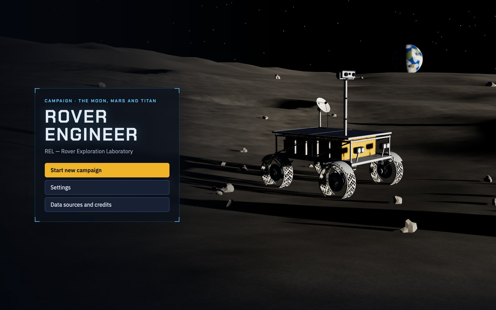
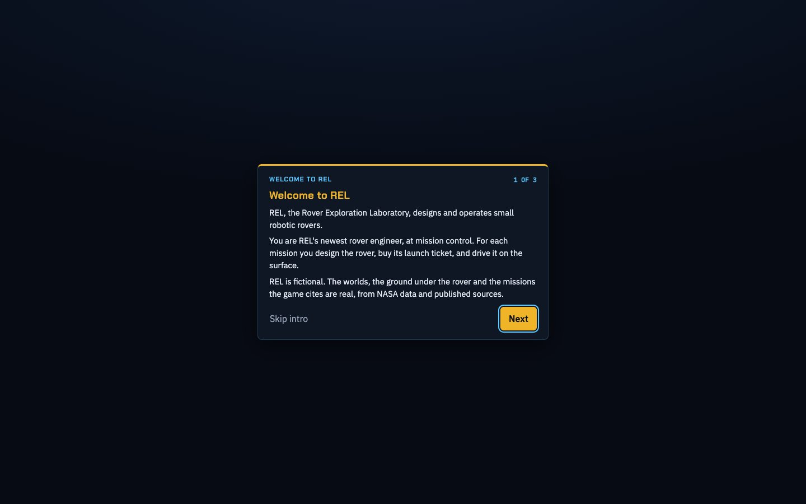
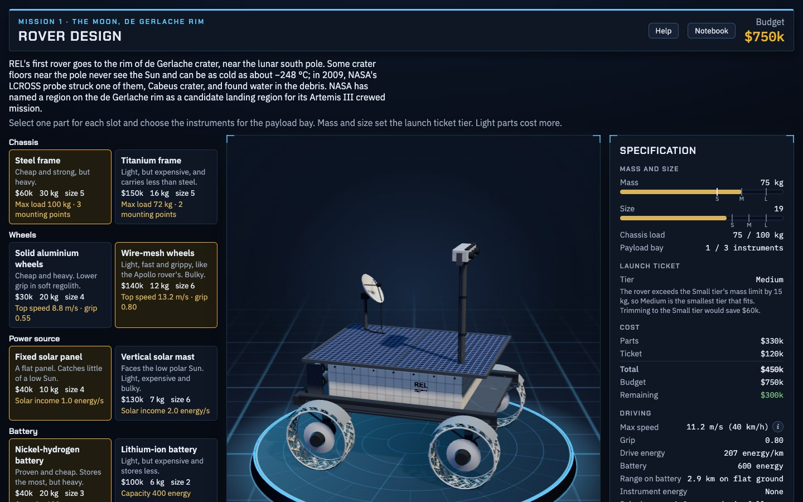
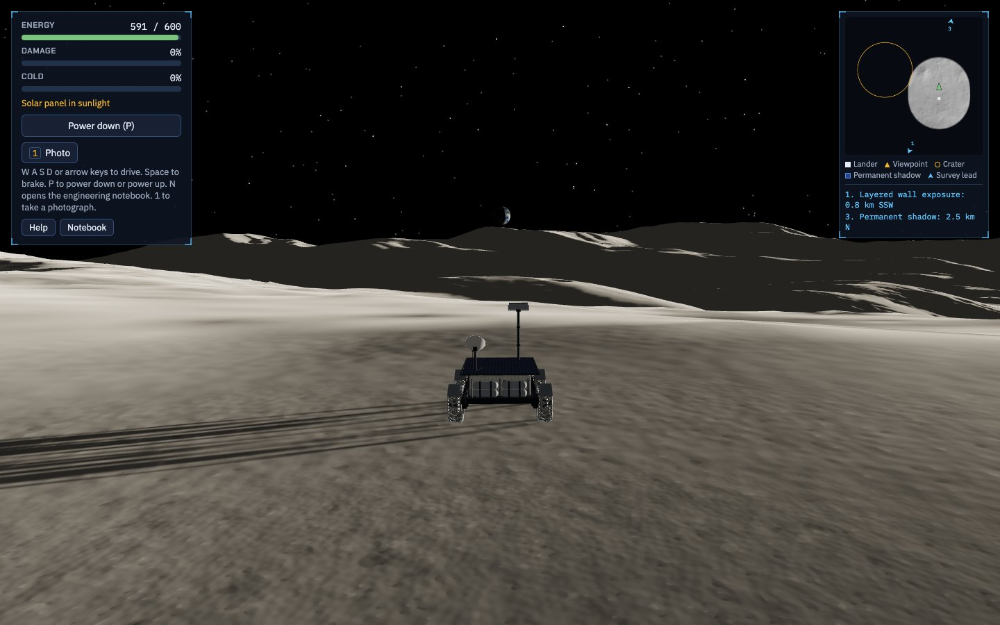
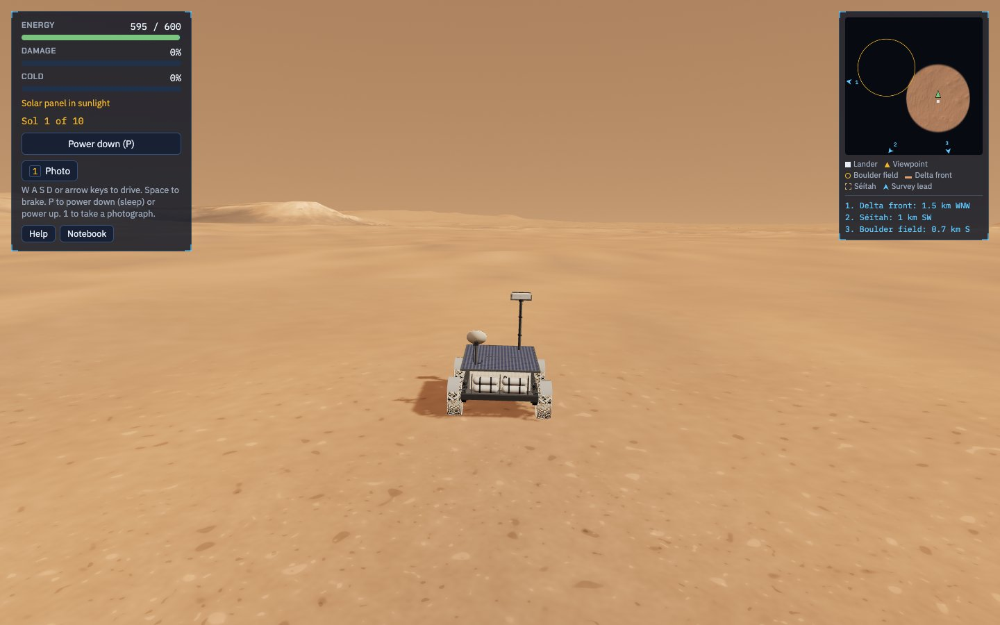
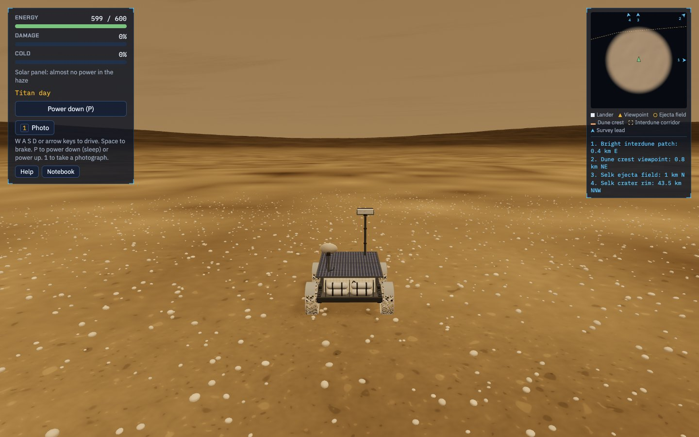
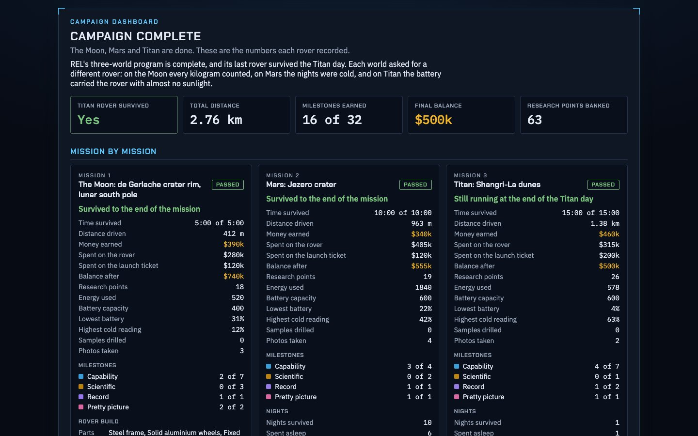

# Rover Engineer

A free 3D browser game about designing, launching and driving robotic rovers on the Moon, Mars and Titan. Built for the **Space Mission Design Game** challenge at NASA Space Apps Challenge 2026.



**Code written with AI assistance** (Anthropic Claude via Claude Code); see [the AI disclosure](space-mission-design-game/submission/ai-disclosure.md). Licensed under the MIT License (see [LICENSE](LICENSE)).

## The game

You are the newest rover engineer at **REL**, the Rover Exploration Laboratory, a fictional agency. Each mission, you design a rover within a budget, buy it a seat on the next launch, and drive it in real time once it lands. To reach the next world, the mission has to earn back what the rover and its launch cost.



### Design the rover

Choose a part for each slot: chassis, wheels, power source, battery, lights, heater, and the instruments in the payload bay. A specification sheet shows mass, size, cost, speed and range as you build, and a 3D preview assembles the rover live. Every part trades capability against mass and cost:

- **Mass and size set the launch ticket tier.** A heavier or bulkier rover needs a pricier ticket, and above the top tier it cannot launch.
- **Mass also changes the drive.** A heavier rover is slower, uses more energy per meter, sinks deeper in soft soil, and can overload its frame.
- **Instruments decide what science is possible.** A camera photographs viewpoints, a drill takes samples, a neutron spectrometer senses hidden hydrogen. A rover without the right instrument drives past the reward.

There is no single right build. On the Moon, a light camera scout, a drill geologist and a cold-proofed ice hunter can all pass, each by doing a different job along a route that suits it. A rover thrown together falls short.



### Drive the mission

The rover lands and you drive it in 3D. There is no clock: you read time from the Sun and the shadows.

- **Energy.** Driving drains the battery; solar panels recharge it only in sunlight. Running out ends the mission.
- **Hazards.** Rocks and steep slopes cause damage, rolling over destroys the rover, soft ground can trap it, and cold zones freeze it without a heater.
- **Events.** Real solar flares from NASA's DONKI database (power down or hide in shadow), moonquakes, Martian dust storms, Titan methane rain.
- **Exploration.** The minimap starts small and grows as you explore. Orbital survey leads point toward areas worth a visit.
- **Milestones** earn money and research points: distance driven, crossing a boulder field, photographing Earth on the horizon, sampling regolith, finding water ice in a dark crater.

Afterwards, a debrief lists what the rover achieved, the money earned and spent, the lessons it learned, and the cause of any failure next to a real rover that met a similar fate.



### Three worlds, three lessons

| Mission | Site | Play time | The new constraint |
| --- | --- | --- | --- |
| 1. The Moon | de Gerlache crater rim, near the south pole | 5 min (one lunar day, 14 Earth days) | Mass versus cost. The low Sun circles the horizon, shadows sweep the land, and permanently shadowed craters hide ice in deep cold. |
| 2. Mars | Jezero crater floor | 10 min (10 sols) | Energy through day and night. Each sol ends in a cold night: keep the lights on or sleep. A dust storm cuts solar power. |
| 3. Titan | Shangri-La dunes near Selk crater | 15 min (one Titan day, about 16 Earth days) | A fixed power budget in deep cold. Sunlight is too weak for solar panels, and the goal is to survive the long night. |





At the end, a campaign dashboard sums up all three missions.



### Built on NASA data

- **Terrain:** the drivable 8 km × 8 km Moon map is the real de Gerlache rim from LRO's Lunar Orbiter Laser Altimeter (LOLA), with real distant mountains on the horizon from LOLA polar elevation models.
- **Light and cold:** shadows are computed from the real topography and checked against LOLA illumination maps. The permanent-shadow map places the cold zones and the hidden ice.
- **Imagery:** the Moon's ground texture is an LROC Narrow Angle Camera mosaic.
- **Events:** each solar flare is a real X-class event from NASA's DONKI database, named by class and date.
- **Soil:** wheel sinkage and getting stuck follow Apollo 15 Lunar Roving Vehicle results.
- **History:** optional facts on milestones and in the debrief cite NASA sources, listed on the credits screen.

Money values are game values, and driving is about four times faster than real. The game says so openly. The full data list is in [game-design.md §9](space-mission-design-game/game-design.md#9-nasa-data).

### Controls

| Key | Action |
| --- | --- |
| W A S D or arrow keys | Drive |
| Space | Brake |
| P | Power down or power up |
| 1, 2, 3 | Use the instruments in the payload bay, in bay order |
| N | Open the engineering notebook |

## Install and run

You need [Node.js](https://nodejs.org/) 22.12 or newer and a modern desktop browser with WebGL (Chrome, Edge, Firefox or Safari).

```bash
git clone https://github.com/chieri518/rover-engineer.git
cd rover-engineer/game
npm install
npm run dev
```

Then open the URL Vite prints (by default http://localhost:5173).

| Command (in `game/`) | What it does |
| --- | --- |
| `npm run dev` | Starts the local dev server with hot reload |
| `npm test` | Runs the rules tests (Vitest) |
| `npm run build` | Typechecks and builds the production game into `game/dist` |
| `npm run preview` | Serves the production build locally |

The production build uses relative paths, so `game/dist` can be served from any static host or sub-path.

**Shortcuts for testing:** `?world=mars` or `?world=titan` starts on that world's design desk, and `?dashboard=demo` shows a sample campaign dashboard.

**Tech:** TypeScript, [Three.js](https://threejs.org/) (3D rendering), [Rapier](https://rapier.rs/) (physics), [Vite](https://vite.dev/) (build) and [Vitest](https://vitest.dev/) (tests). The NASA datasets are turned into game files by a Python pipeline (rasterio and NumPy) in `game/tools/`.

## Future work

Areas we want to change or improve that we did not have time to finish before the challenge submission:

- **Better worldbuilding, story and introduction.**
- **Mars and Titan instruments, components and milestones.** Mars and Titan currently play with the Moon's parts. Planned but not implemented.
- **Balance tuning** of the cost and reward of components and milestones.
- **An unlock tree** for instruments and components, earned by doing science. Research points are earned but do not unlock anything yet.
- **An improved rover engineering desk.** Show previews of each component while choosing it, not just its name.

## Repository

```
rover-engineer/
├── README.md                          ← you are here
├── game/                              The game (Vite + TypeScript + Three.js + Rapier)
│   ├── data/                          All game numbers and text, as JSON
│   ├── src/                           Game code; src/rules/ holds the pure, tested rules
│   ├── public/terrain/                Terrain files generated from NASA data
│   └── tools/                         Python pipeline that builds the terrain files
├── docs/screenshots/                  Screenshots for this page
├── space-apps-2026-event-guide.md     Event rules, dates, judging, submission package
└── space-mission-design-game/
    ├── README.md                      Project index
    ├── game-design.md                 ★ The living game design: decisions, open questions, build order
    ├── challenge-brief.md             The official brief and feature register
    ├── submission/                    Project description, AI disclosure, publish checklist
    ├── research/                      Rover and mission engineering research, judging evidence
    └── reference-pdfs/                Local copies of NASA/JPL source documents
```

| If you want to… | Read |
| --- | --- |
| Know how the game is designed | [Game design](space-mission-design-game/game-design.md) |
| See what NASA asked for | [Challenge brief](space-mission-design-game/challenge-brief.md) |
| Read the submission text | [Project description](space-mission-design-game/submission/project-description.md) |
| Look up a real rover fact or number | [Rover engineering research](space-mission-design-game/research/rover-engineering/README.md) |
| Find the NASA datasets behind the Moon map | [NASA data for the game](space-mission-design-game/research/rover-engineering/07-nasa-data-for-the-game.md) |
| Contribute code | [CLAUDE.md](CLAUDE.md) for the code rules, then the [implementation plan](space-mission-design-game/implementation-plan.md) |

More detail is in the [project index](space-mission-design-game/README.md).
